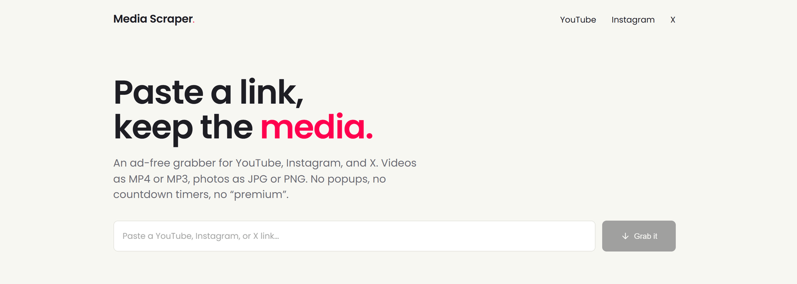
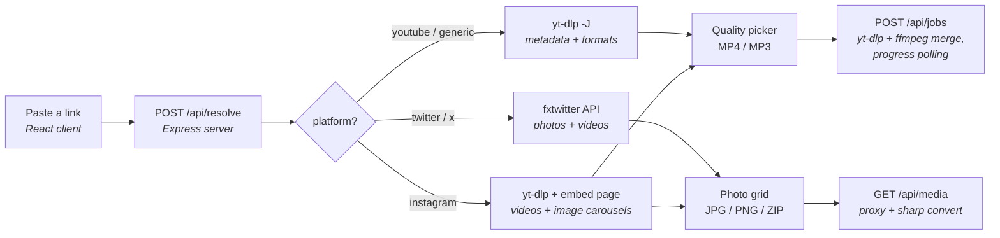

# Media Scraper

Paste a link, keep the media. An ad-free grabber for YouTube, Instagram, and X — video as
MP4 or MP3, photos as JPG or PNG. No popups, no countdown timers, no "premium" tier.



I built this because every free downloader site is a minefield of fake download buttons and
redirect chains. This one runs on your own machine, does exactly what the button says, and
keeps nothing.

## Videos

Paste a YouTube link — or a reel, or a video tweet — and you get the real format list that
yt-dlp reports: every available height, its frame rate, and an estimated file size. Most
downloader sites offer "HD" and "SD" and hope you don't ask. There's also an MP3 option
that rips the audio track on its own.

Downloads run as jobs on the server. yt-dlp fetches the video and audio streams, ffmpeg
merges them into an MP4, and the browser polls for progress while it happens.

Choose **GIF animation** to save a video or X GIF attachment as an actual `.gif` file.
ffmpeg converts the full clip into a silent, looping animation, up to 640 pixels wide
at 15 fps. MP4 remains available for smaller files and higher quality.

## Photos

Photo posts come back as a grid. Every image in an Instagram carousel or a multi-photo
tweet is selectable: download one, download the few you picked, or take the whole set as a
single ZIP. JPG and PNG are both available, converted server-side as the image streams
through.

## How it works

Scraping can't be done from the browser alone — platforms block cross-origin fetches and
hotlinking, so a pasted link has to be resolved somewhere else. Media Scraper is two npm
workspaces: a React client and a small Express API that fronts yt-dlp.



A few notes on the pieces:

- yt-dlp does the extraction. `youtube-dl-exec` downloads the binary on install, and
  `ffmpeg-static` supplies the ffmpeg used for merging and MP3 extraction — no Python or
  system installs needed.
- Photo tweets dead-end in yt-dlp, so X links go through the fxtwitter API instead, which
  reports every attachment in one call. Instagram image carousels come from the public
  embed page's inline JSON.
- `sharp` converts photos to JPG or PNG on the fly as they pass through the `/api/media`
  proxy, which also exists to get around CORS and hotlink protection.
- Photo ZIPs are built in the browser with `fflate`; the server only streams the images.
- Video jobs write into per-job temp directories under the system temp folder, deleted as
  soon as the file has been streamed. Anything left behind gets swept hourly.

Links from other sites usually work too, since anything yt-dlp supports flows through the
generic path. They just don't get a platform badge in the UI.

## Code structure

```
web-scrapper/
├── package.json          npm workspaces root: `npm run dev` starts both apps
├── docs/                 README screenshots
├── server/               Express API (port 5175)
│   ├── index.js          routes: /api/resolve, /api/media, /api/jobs
│   └── lib/
│       ├── ytdlp.js      yt-dlp wrapper, shared flags, friendly error mapping
│       ├── normalize.js  raw yt-dlp JSON → { platform, items[] } shape
│       ├── resolve.js    per-platform resolution strategy
│       ├── twitter.js    fxtwitter API (photo tweets + video enrichment)
│       ├── instagram.js  embed-page scrape for image posts and carousels
│       ├── media.js      image proxy + sharp JPG/PNG conversion
│       └── jobs.js       download job manager: spawn, progress, stream, cleanup
└── client/               Vite + React + MUI (port 5173, /api proxied to 5175)
    └── src/
        ├── theme/        palette and MUI theme factory
        ├── components/
        │   ├── layout/   Header, Footer, AppLayout, Logo
        │   ├── common/   Button, SegmentedControl
        │   └── scrape/   LinkInput, VideoCard, GalleryCard
        ├── pages/        ScrapePage — hero plus the idle/loading/done/error states
        └── utils/        api client, download and zip helpers, formatters
```

## Running locally

Needs Node 20 or newer. The first install pulls down the yt-dlp and ffmpeg binaries
automatically.

```bash
npm install
npm run dev
```

Open http://localhost:5173. The API listens on 5175 and Vite proxies `/api` to it.

| Command               | What it does                                          |
| :-------------------- | :---------------------------------------------------- |
| `npm run dev`         | Start the API and client together                      |
| `npm run build`       | Build the client for production                        |
| `npm start`           | Serve the API and the built client from one process    |
| `npm run package:win` | Build the portable Windows app with `MediaScraper.exe` |

## Portable Windows build

`npm run package:win` assembles a self-contained app in `dist-win\MediaScraper\`:

```
MediaScraper/
├── MediaScraper.exe   double-click to run: starts the server, opens the browser
├── node/node.exe      bundled Node runtime
├── server/            API plus production deps (yt-dlp, ffmpeg, sharp included)
└── client/dist/       built frontend, served on http://localhost:5175
```

Double-clicking `MediaScraper.exe` opens a console window with the server logs and launches
the app in your default browser; closing the console stops it. The folder can be moved or
copied to any Windows PC and nothing needs to be installed there.

A true single-file exe isn't practical: yt-dlp, ffmpeg, and sharp are native binaries that
have to live on disk next to the app anyway.

## Instagram and age-restricted content

Public reels and most posts work as-is. Private accounts, some carousels, and age-restricted
videos need a logged-in session:

1. Install a "cookies.txt" browser extension, such as *Get cookies.txt LOCALLY*.
2. Log in to the site in your browser and export the cookies in Netscape format.
3. Save the file as `server/cookies.txt`. It's gitignored — never commit it.

Every yt-dlp call picks it up automatically.

## A note on use

This is a personal tool, meant as an alternative to sketchy downloader sites rather than a
way around anyone's terms of service. Download only content you have the right to save:
your own posts, licensed or Creative Commons media, and so on.

Extractors track how platforms behave, so they break from time to time. Updating yt-dlp
(`npm update youtube-dl-exec`) usually fixes it.
